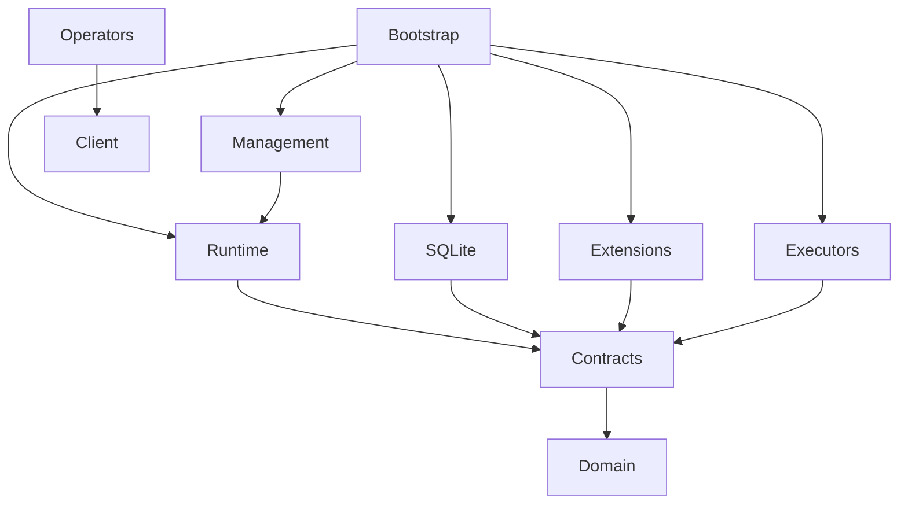

# Planned Go package boundaries

Decision B01, ticket 01-01. These are ownership and import rules for the interfaces and scaffold in 01-02–01-06. Ticket 01-03 adds `extension`, `observability` and their conformance fixtures ([B03](extensions.md)). Ticket 01-02 implements `domain`, `storage`, shared storage cases in `conformance` and a volatile double in `conformance/reference`. It introduces `github.com/alsiola/open-conduit` with the source baseline’s Go minimum (1.24.2) to run those contracts; 01-06 reviews the supported toolchain/platforms and adds the remaining scaffold/CI.

| Package | Owns | Allowed project dependencies |
| --- | --- | --- |
| `domain` | Five primitive records, identifiers, envelopes, revisions, lifecycle/outcomes and mechanical capabilities; opaque domain data | None |
| `extension` | Public ingress observations, deterministic route handlers, registration, toolbelt operations, executor and optional resource contracts | `domain` |
| `storage` | Public transactional guarantees, event/work/lease/timer/KV operations and separate artifact interface | `domain` |
| `observability` | Public lifecycle hooks, correlation and executor measurements | `domain` |
| `conformance` | Reusable public contract suites, fixtures, fake clock, synchronization barriers and reference doubles | Public packages above; no production implementations |
| `internal/runtime` | Durable event acceptance, observation diffing, routing serialization, scheduling, leases, retry, wait/wake, causation limits | Public packages above except `conformance` |
| `internal/storage/sqlite` | SQLite transactions, migrations and durability | `storage`, `domain` |
| `internal/artifacts` | Streaming local logs/outputs and retention implementation | `storage`, `domain` |
| `internal/config` | Scope configuration loading, validation, secret resolution, reload snapshots | `domain`, `extension` |
| `internal/management` | Local authenticated management and toolbelt server, calling generic runtime operations | Public packages, `internal/runtime`, `internal/config` |
| `client` | Public local API client and wire types for operators/extensions | `domain`; public contracts where needed, never server internals |
| `internal/cli`, `internal/tui` | Operator controls and unified history presentation | `client`, public packages; config editing through management/bootstrap services |
| `extensions/{github,slack,jira,linear,bitbucket}` | Payload schemas, ingress reads/writes/markers, projections, domain routes and tool operations | Public packages and service SDKs; no runtime or SQLite imports |
| `extensions/git` | Optional resource provider: shared/fresh workspace, copying, setup, cleanup | Public packages and process/filesystem utilities |
| `extensions/{schedule,introspection,host,posthog,tunnel}` | Scheduling rules, reporting/sweep/triage, host readings, telemetry export and webhook exposure | Public packages and service libraries; `client` if calling management |
| `executors/shell`, `executors/claudecode` | Execution processes, adoption and executor-private continuity; CLI/MCP toolbelt presentation | Public packages, `client`, generic process helpers; no runtime/SQLite imports |
| `internal/bootstrap`, `cmd/open-conduit`, `cmd/os` | Composition root and entrypoints; wire implementations and optional registrations | Packages required to assemble the binary; `cmd/os` uses `client` |

Arrows below mean “imports”; implementations point toward contracts. Bootstrap is the only place that assembles all implementations.

`Contracts` represents `extension`, `storage` and `observability`. Public interfaces must not return concrete implementation types. Optional workspace context crosses the resource contract as a generic resource descriptor; Git acquisition semantics stay in 03-02. No `Issue`, `PR`, label enum, process session handle or Claude continuation type belongs in `domain` or `internal/runtime`. Snapshot diffing operates on opaque identities/revisions, not service payload fields. Retry/outcome decisions use generic policy; tracker-specific status mapping lives in projections.

Runtime must not import extensions, executors, client, management, config implementation, SQLite or Git workspace code, directly or transitively. Domain behavior belongs outside runtime. The executor owns session identity, resume-versus-fresh decisions, handoff assignment/feedback telemetry and opaque adoption state; runtime owns generic authority and execution history. Extensions use storage only through the public transaction/KV surface, never implementation tables. Resource consumers bind the public provider interface rather than importing `extensions/git`.

In 01-06, enforce this graph with a transitive `go list -deps -json` import check, including runtime tests so test imports cannot smuggle in an adapter. Verify conformance suites can run without runtime/SQLite. In 02-09 and 05-04 run a core slice with no Git or service registration; exercise opaque synthetic payloads. Go's `internal` rules alone do not enforce these boundaries.

Non-goals for stages 01–06: no Effect primitive/outbox state machine, DAG, workflow language, remote management or third-party extension protocol/manifest. Adapters reconcile writes and mark messages whose effects cannot be re-derived. Namespaced KV is mandatory coordination storage, not a second event log or artifact warehouse. Subprocess transport and schema evolution are deferred to 07-01–07-03 after shipped workload evidence.

Decisions deliberately left to their tickets: lifecycle/storage fencing ([B02](domain-storage.md), delivered in 01-02); ingress completeness and push overlap ([B03](extensions.md), delivered in 01-03); ordering, wait races and active policy (01-04); config inheritance/reload/auth (01-05); workspace contract (03-02); generic injection acknowledgements (04-02); pending job coalescing (05-01). These decisions must preserve the boundaries above.
