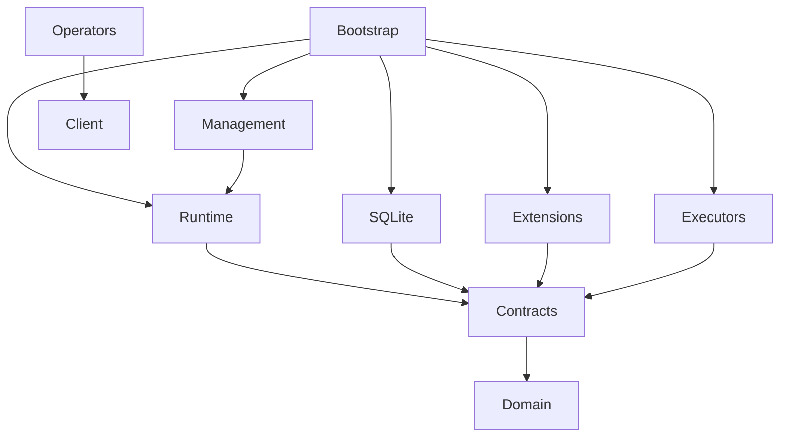

Decision B01, ticket 01-01. These are ownership and import rules for the interfaces and scaffold in 01-02–01-06. Ticket 01-03 adds `extension`, `observability` and their conformance fixtures ([B03](../extensions/)). Ticket 01-02 implements `domain`, `storage`, shared storage cases in `conformance` and a volatile double in `conformance/reference`. It introduces `github.com/open-conduit/open-conduit` with Go 1.24.2 as its minimum to run those contracts; 01-06 reviews the supported toolchain/platforms and adds the remaining scaffold/CI.

| Package | Owns | Allowed project dependencies |
| --- | --- | --- |
| `domain` | Five primitive records, identifiers, envelopes, revisions, lifecycle/outcomes and mechanical capabilities; opaque domain data | None |
| `extension` | Public ingress observations, deterministic route handlers, registration, toolbelt operations, executor and optional resource contracts | `domain` |
| `storage` | Public transactional guarantees, event/work/lease/timer/KV operations and separate artifact interface | `domain` |
| `observability` | Public lifecycle hooks, correlation and executor measurements | `domain` |
| `conformance` | Reusable public contract suites, fixtures, fake clock, synchronization barriers and reference doubles | Public packages above; no production implementations |
| `internal/runtime` | Durable event acceptance, observation diffing, routing serialization, scheduling, leases, retry, wait/wake, causation limits | Public packages above except `conformance` |
| `internal/storage/sqlite` | SQLite transactions, migrations and durability | `storage`, `domain` |
| `internal/artifacts` | Streaming local logs/outputs and retention implementation | `storage`, `domain` |
| `internal/backup` | Local SQLite/artifact snapshot composition, manifest verification and isolated restore | `storage`, `domain`, `internal/storage/sqlite`, `internal/artifacts`; never runtime or adapters |
| `internal/config` | Scope configuration loading, validation, secret resolution, reload snapshots | `domain`, `extension` |
| `internal/management` | Local authenticated management and toolbelt server, calling generic runtime operations | Public packages, `internal/runtime`, `internal/config` |
| `client` | Public local API client and wire types for operators/extensions | `domain`; public contracts where needed, never server internals |
| `internal/telemetry` | Lifecycle export pipeline (validation, redaction, bounded buffering/drop accounting, per-exporter isolation), OpenTelemetry API mapping and local JSON log exporter | Public packages and the OpenTelemetry API; exporter configuration stays in extensions |
| `internal/cli`, `internal/tui` | Operator controls and unified history presentation (`internal/cli/runview` renders shared history rows) | `client`, public packages; config editing through management/bootstrap services |
| `extensions/{github,slack,jira,linear,bitbucket}` | Payload schemas, ingress reads/writes/markers, projections, domain routes and tool operations | Public packages and service SDKs; no runtime or SQLite imports |
| `extensions/git` | Optional resource provider: shared/fresh workspace, copying, setup, cleanup | Public packages and process/filesystem utilities |
| `extensions/{schedule,introspection,host,posthog,tunnel}` | Scheduling rules, reporting/sweep/triage, host readings, telemetry export and webhook exposure | Public packages and service libraries; `client` if calling management |
| `executors/shell`, `executors/claudecode` | Execution processes, adoption and executor-private continuity; CLI/MCP toolbelt presentation | Public packages, `client`, generic process helpers; no runtime/SQLite imports |
| `protocol` | The extracted third-party subprocess protocol (07-01): version, manifest validation, method catalogue and error codes; wire types, error mapping and payload schema evolution (07-02) | Public packages only |
| `protocol/jsonrpc`, `protocol/sdk`, `protocol/examples/*` | The transport, the minimal extension-side SDK, and the example external extension (`notes`) and executor (`runner`) with their commands (07-02) | Public packages and `protocol/*` only, exactly as a third party would |
| `internal/extproc` | Host runtime for extension processes (07-02): discovery, atomic conflicts, supervised processes, the scoped extension-to-host service and adapters onto the public contracts; install, update, rollback, removal and diagnostics (07-03) | Public packages, `protocol/*` and `internal/runtime`; never SQLite, bootstrap or another extension |
| `internal/certify` | The extension conformance runner (07-03), shipped as `open-conduit extension certify` | Public packages, `protocol/*`, `conformance` (never `conformance/reference`), `internal/extproc`, `internal/runtime`, SQLite and artifacts |
| `packages/<name>` | First-party subprocess packages (07-03): `packages/slack` serves `extensions/slack`, `packages/shell` serves `executors/shell`, each over `protocol/sdk` with its command | Public packages, `protocol/*` and the one implementation it wraps |
| `internal/bootstrap`, `cmd/open-conduit`, `cmd/os` | Composition root and entrypoints; wire implementations and optional registrations | Packages required to assemble the binary; `cmd/os` uses `client` |

Arrows below mean “imports”; implementations point toward contracts. Bootstrap assembles runtime implementations; the local backup service composes only SQLite and artifact storage.

`Contracts` represents `extension`, `storage` and `observability`. Public interfaces must not return concrete implementation types. Optional workspace context crosses the resource contract as an opaque host-bound `ResourceBroker`; Git acquisition semantics are [B07](../workspaces/) (03-02). No `Issue`, `PR`, label enum, process session handle or Claude continuation type belongs in `domain` or `internal/runtime`. Snapshot diffing operates on opaque identities/revisions, not service payload fields. Retry/outcome decisions use generic policy; tracker-specific status mapping lives in projections.

Runtime must not import extensions, executors, client, management, config implementation, SQLite or Git workspace code, directly or transitively. Domain behavior belongs outside runtime. The executor owns session identity, resume-versus-fresh decisions, handoff assignment/feedback telemetry and opaque adoption state; runtime owns generic authority and execution history. Extensions use storage only through the public transaction/KV surface, never implementation tables. Resource consumers bind the public provider interface rather than importing `extensions/git`.

01-06 enforces this graph with [the boundary checker](https://github.com/open-conduit/open-conduit/blob/main/scripts/check-boundaries/main.go) and [gate documentation](../contracts-gate/). Implementation tests may import public contracts and the public `conformance` harness (including its public-contract dependency closure). Runtime tests may use that harness, but not `conformance/reference`, adapters or SQLite; real backend/workload composition belongs in `integration/` outside runtime. Both commands share `internal/cli`: `open-conduit` operator commands and, since 02-07, the `os` toolbelt CLI, each calling the management API only through `client`. Since 02-08 the TUI is injected by the `open-conduit` entrypoint (`cli.Env.TUI`), so `os` carries no terminal UI. `executors/shell` (02-07) imports only public contracts. Since 03-01, `extensions/github` imports only public contracts. Its `extensions/github/githubtest` REST fake is test support used by extension and integration tests, never by production code. `internal/bootstrap` registers it. Since 03-02, `extensions/git` ([B07](../workspaces/)) imports only public contracts plus process/filesystem utilities. Since 03-04, `extensions/github` also holds the engineering tool operations, the in-process `github-hold` executor (which reaches the toolbelt through the public `client`) and `extensions/github/playbooks` (embedded playbooks and plugin preparation), all on public contracts. Since 03-03, `executors/claudecode` ([Claude Code executor](../claude-code-executor/)) imports only public contracts. It keeps its own copy of the shell executor's process-identity helpers, because executors cannot import each other. A host adapter reaches GitHub feedback comments (`extensions/github.WorkComments`) through the executor's `FeedbackHook` interface. Executors reach it only through `extension.ResourceBroker`, and runtime sees only that opaque broker. It traverses `go list -deps -test -json` output, including runtime tests so test imports cannot smuggle in an adapter. Conformance suites run without runtime/SQLite. In 02-09 and 05-04 run a core slice with no Git or service registration; exercise opaque synthetic payloads. 02-09 adds `internal/bootstrap`, the composition root behind `open-conduit serve`; `internal/cli` reaches it only through the injected `cli.Env.Serve`, and its kill-drill fault injector compiles only under the `faultinject` build tag. Go's `internal` rules alone do not enforce these boundaries.

Non-goals for stages 01–06: no Effect primitive/outbox state machine, DAG, workflow language, remote management or third-party extension protocol/manifest. Adapters reconcile writes and mark messages whose effects cannot be re-derived. Namespaced KV is mandatory coordination storage, not a second event log or artifact warehouse. Subprocess transport and schema evolution are deferred to 07-01–07-03 after shipped workload evidence.

Decisions deliberately left to their tickets: lifecycle/storage fencing ([B02](../domain-storage/), delivered in 01-02); ingress completeness and push overlap ([B03](../extensions/), delivered in 01-03); ordering, wait races and active policy ([B04](../runtime-semantics/), delivered in 01-04); config inheritance/reload/auth ([B05](../config-management/), delivered in 01-05); workspace contract ([B07](../workspaces/), delivered in 03-02); generic injection acknowledgements (04-02); pending job coalescing (05-01). These decisions must preserve the boundaries above.

03-05 adds `extensions/tunnel` (ngrok, cloudflared and static webhook exposure, standard library only). `internal/cli` reaches the daemon registry's offline validation (`bootstrap.ValidateConfig`) and the setup agent (`bootstrap.SetupCommand`) only through the injected `cli.Env.ValidateConfig` and `cli.Env.Setup`, as it does for `Serve`. `internal/tui` may use `internal/cli` (claim and attach helpers) and stays free of executor and domain branches.

04-01 adds `extensions/slack` ([Slack extension](../slack-extension/)), on public contracts plus the standard library (including its own minimal WebSocket client for Socket Mode, so no new module). Its `extensions/slack/slacktest` fake is test support only. `internal/bootstrap` registers it; no Git or workspace code is involved.

04-02 moves setup into the extensions. `internal/cli` hosts the public `extension.Setup` values that `cmd/open-conduit` injects through `cli.Env.Setups` (from `bootstrap.Setups()`), and never imports an extension package; the boundary checker's tests now name the core CLI/TUI cases explicitly. `extensions/slack/playbooks` holds the support playbook, which bootstrap writes into the Claude Code plugin beside the GitHub playbooks.

05-01 adds `extensions/schedule` ([scheduled jobs](../schedule-extension/)) on public contracts plus `github.com/robfig/cron/v3`. It does not import `extensions/github`. `internal/bootstrap` maps the raw `github.delivery` payload into the extension's `Delivery`. It also registers the route handler, the timer recurrence, the job Work kind policy and the webhook mount.

05-02 keeps `extensions/schedule` on public contracts: GitHub job waits resolve through a bootstrap-injected function, so neither extension imports the other.

03-08 adds `extensions/introspection` ([issue reporting](../issue-reporting/)) on public contracts only (`domain`, `extension`, `storage`), with its triage playbook in `extensions/introspection/playbooks`. No core package imports it. A boundary case and a source scan (`TestNoPrivilegedReportingPath`) keep reporting, introspection and triage vocabulary out of core, contract and operator packages.

05-03 completes `extensions/introspection` ([introspection](../issue-reporting/)). It adds `observability` among its public imports (the telemetry exporter), `github.com/robfig/cron/v3` for its calendar, and the sub-package `extensions/introspection/host` (using `golang.org/x/sys/unix`). The planned separate `extensions/host` is folded into it: the host watch is an optional introspection feature whose crossings are reports. It still imports no other extension: it reads the GitHub tools' `github.notes` records as a documented data contract through public storage, and it writes only its own namespaces. The source scan also covers sweep slots, fix requests and the host watch config.

06-01 adds `extensions/tracker`, the shared tracker kit ([installed integrations](../installed-integrations/)): ingress, route, projector, outbox and tools over a small `Service`, on public contracts only (plus `extensions/tracker/playbooks`). `extensions/linear`, `extensions/jira` and `extensions/bitbucket` may import it; no other extension may, and it reaches no extension (boundary cases `trackers_use_kit`, `kit_cannot_reach_github`, `slack_cannot_use_kit`, `linear_cannot_reach_jira`, `runtime_cannot_import_kit`). Their `lineartest`, `jiratest` and `bitbuckettest` fakes are test support only. `extensions/posthog` imports `observability` and the standard library. `internal/cli` hosts the adapter catalog (`cli.Env.Adapters`) and the config editor (`cli.Env.EditConfig`, implemented in `internal/tui`) through injected functions, so neither `os` nor `internal/cli` imports an extension or the TUI.

06-02 adds the offline state operations in `internal/bootstrap/state.go` ([recovery](../recovery/)). `internal/cli` reaches them only through the injected `cli.Env.State`.

07-01 adds the public `protocol` package ([extension protocol](../extension-protocol/)), which may import only public contracts, and which `extension` may not import; the boundary checker has a rule and four cases for it. The transport comparison lives in `prototypes/transport`, a separate Go module (with its own `go.mod`) so go-plugin and gRPC stay out of the main module; `./...` patterns, `make check` and the boundary checker do not include it, and `make protocol-prototype` runs it. The daemon's private stop interface and its claude-code attach branch are replaced by the public `extension.StopExecutor` and `extension.AttachExecutor`.

07-02 adds `protocol/jsonrpc`, `protocol/sdk`, the examples under `protocol/examples` and `internal/extproc` ([runtime, trust model and schema evolution](../extension-protocol/#runtime-trust-model-and-schema-evolution-07-02)). The boundary checker has two rules and six cases for them. The new public conformance suite `conformance.RunExtensionKV` covers the namespaced KV an extension reaches through the host. The examples' binaries are built by the integration tests and are not part of the shipped binaries; bootstrap does not load extensions yet (07-03).

07-03 adds `internal/certify` and `packages/{slack,shell}` with boundary rules and seven cases, `protocol/examples/weakened` (the certification negative controls, under the `protocol/*` rule) and the daemon wiring in `internal/bootstrap/extensions.go` ([extension packaging, SDK and certification](../extension-packaging/)). Composition may now depend on the public `conformance` checks, never on `conformance/reference`, because the certification runner ships in the `open-conduit` binary. `make packages` builds the package directories; `make certify` runs the runner and the negative controls.
