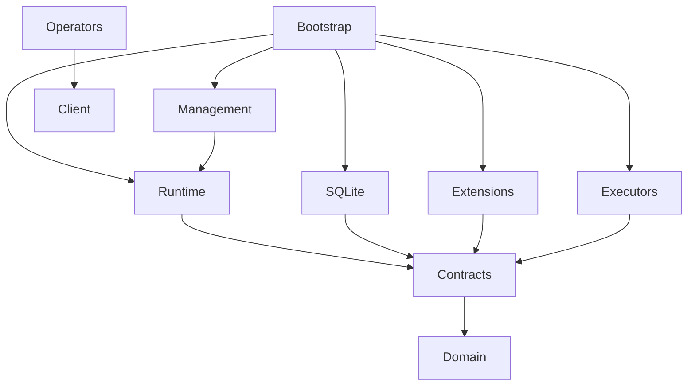

This page records decision B01: the ownership and import rules for every Go package in Open Conduit. The module is `github.com/open-conduit/open-conduit`, with Go 1.24.2 as its minimum. [The boundary checker](https://github.com/open-conduit/open-conduit/blob/main/scripts/check-boundaries/main.go) enforces these rules over the resolved production and test dependency graph as part of `make check` ([development checks](../contracts-gate/)). A new package needs an explicit ownership entry here and in the checker before it can import anything.

| Package | Owns | Allowed project dependencies |
| --- | --- | --- |
| `domain` | Five primitive records, identifiers, envelopes, revisions, lifecycle/outcomes and mechanical capabilities; opaque domain data | None |
| `extension` | Public ingress observations, deterministic route handlers, registration, toolbelt operations, executor and optional resource contracts | `domain` |
| `storage` | Public transactional guarantees, event/work/lease/timer/KV operations and separate artifact interface | `domain` |
| `observability` | Public lifecycle hooks, correlation and executor measurements | `domain` |
| `extension/inproc` | The in-process extension contract: the optional surfaces an extension inside the daemon offers and the host services it gets | Public packages only |
| `conformance` | Reusable public contract suites, fixtures, fake clock, synchronization barriers and reference doubles | Public packages above; no production implementations |
| `internal/runtime` | Durable event acceptance, observation diffing, routing serialization, scheduling, leases, retry, wait/wake, causation limits | Public packages above except `conformance` |
| `internal/storage/sqlite` | SQLite transactions, migrations and durability | `storage`, `domain` |
| `internal/artifacts` | Streaming local logs/outputs and retention implementation | `storage`, `domain` |
| `internal/backup` | Local SQLite/artifact snapshot composition, manifest verification and isolated restore | `storage`, `domain`, `internal/storage/sqlite`, `internal/artifacts`; never runtime or adapters |
| `internal/config` | Scope configuration loading, validation, secret resolution, reload snapshots | `domain`, `extension` |
| `internal/management` | Local authenticated management and toolbelt server, calling generic runtime operations | Public packages, `internal/runtime`, `internal/config` |
| `internal/migrate` | Explicit conversion of an older configuration format into extension and executor config (`open-conduit migrate config`), and renaming extension settings a release renamed in an Open Conduit config (`open-conduit migrate upgrade`) | Public packages, `client` and the exported names and setup shapes of `extensions/*` and `executors/*`; never runtime, SQLite, management or bootstrap |
| `client` | Public local API client and wire types for operators/extensions | `domain`; public contracts where needed, never server internals |
| `extensiontest` | The test harness a package's own repository uses: the real daemon, built from the pinned module and driven through `client`, a scope generated from the package's manifest, and a scripted agent | Public packages and `client`; never `internal/` |
| `internal/telemetry` | Lifecycle export pipeline (validation, redaction, bounded buffering/drop accounting, per-exporter isolation), OpenTelemetry API mapping and local JSON log exporter | Public packages and the OpenTelemetry API; exporter configuration stays in extensions |
| `internal/cli`, `internal/tui` | Operator controls and unified history presentation (`internal/cli/runview` renders shared history rows) | `client`, public packages; config editing through management/bootstrap services |
| `extensions/{github,slack,jira,linear,bitbucket}` | Payload schemas, ingress reads/writes/markers, projections, domain routes and tool operations | Public packages and service SDKs; no runtime or SQLite imports |
| `extensions/tracker` | The shared tracker kit: ingress, route, projector, outbox and tools over a small `Service` | Public packages only; imported only by `extensions/linear`, `extensions/jira` and `extensions/bitbucket` |
| `extensions/git` | Optional resource provider: shared/fresh workspace, copying, setup, cleanup | Public packages and process/filesystem utilities |
| `extensions/srt` | Optional process sandbox provider (B09) wrapping launches in srt | Public packages and process/filesystem utilities |
| `extensions/{schedule,introspection,observe,posthog,tunnel}` | Scheduling rules, reporting/sweep/triage and the host watch (`extensions/introspection/host`), observed sources, telemetry export and webhook exposure | Public packages and service libraries; `client` if calling management |
| `executors/shell`, `executors/claudecode` | Execution processes, adoption and executor-private continuity; CLI/MCP toolbelt presentation | Public packages, `client`, generic process helpers; no runtime/SQLite imports |
| `protocol` | The third-party subprocess protocol: version, manifest validation, method catalogue and error codes; wire types, error mapping and payload schema evolution | Public packages only |
| `protocol/jsonrpc`, `protocol/sdk`, `protocol/examples/*` | The transport, the minimal extension-side SDK, and the example external extension (`notes`) and executor (`runner`) with their commands | Public packages and `protocol/*` only, exactly as a third party would |
| `internal/extproc` | Host runtime for extension processes: discovery, atomic conflicts, supervised processes, the scoped extension-to-host service and adapters onto the public contracts; install, update, rollback, removal and diagnostics | Public packages, `protocol/*` and `internal/runtime`; never SQLite, bootstrap or another extension |
| `internal/certify` | The extension conformance runner, shipped as `open-conduit extension certify` | Public packages, `protocol/*`, `conformance` (never `conformance/reference`), `internal/extproc`, `internal/runtime`, SQLite and artifacts |
| `packages/<name>` | First-party subprocess packages: `packages/slack` serves `extensions/slack`, `packages/shell` serves `executors/shell`, each over `protocol/sdk` with its command; `packages/sentry` is a source written only on `protocol/sdk`, with no in-process twin | Public packages, `protocol/*` and the one implementation it wraps |
| `internal/bootstrap`, `cmd/open-conduit`, `cmd/os` | Composition root and entrypoints; wire implementations and optional registrations | Packages required to assemble the binary; `cmd/os` uses `client` |

Arrows below mean “imports”; implementations point toward contracts. Bootstrap assembles runtime implementations; the local backup service composes only SQLite and artifact storage.

`Contracts` represents `extension`, `storage` and `observability`. Public interfaces must not return concrete implementation types. Optional workspace context crosses the resource contract as an opaque host-bound `ResourceBroker`; Git acquisition semantics are [B07](../workspaces/). No `Issue`, `PR`, label enum, process session handle or Claude continuation type belongs in `domain` or `internal/runtime`. Snapshot diffing operates on opaque identities/revisions, not service payload fields. Retry/outcome decisions use generic policy; tracker-specific status mapping lives in projections.

Runtime must not import extensions, executors, client, management, config implementation, SQLite or Git workspace code, directly or transitively. Domain behavior belongs outside runtime. The executor owns session identity, resume-versus-fresh decisions, per-turn telemetry and opaque adoption state; runtime owns generic authority and execution history. Extensions use storage only through the public transaction/KV surface, never implementation tables. Resource consumers bind the public provider interface rather than importing `extensions/git`.

## Enforcement

[The boundary checker](https://github.com/open-conduit/open-conduit/blob/main/scripts/check-boundaries/main.go) traverses `go list -deps -test -json` output, including runtime tests, so test imports cannot smuggle in an adapter. Go's `internal` rules alone do not enforce these boundaries. Implementation tests may import public contracts and the public `conformance` harness (including its public-contract dependency closure). Runtime tests may use that harness, but not `conformance/reference`, adapters or SQLite; real backend/workload composition belongs in `integration/` outside runtime. Conformance suites run without runtime/SQLite and exercise opaque synthetic payloads; core slices run with no Git or service registration.

The setup extension is an installed package in its own module, [open-conduit/extension-setup](https://github.com/open-conduit/extension-setup), pinned in `go.mod` with a `tool` directive and built only by `scripts/bundle-packages.sh`. No package may import it, or anything under `extensions/setup` again (boundary cases `setup_package_never_imported`, `setup_package_never_imported_transitively`, `setup_never_compiled_back_in`; [#243](https://github.com/open-conduit/open-conduit/issues/243)).

`extensiontest` is imported by other modules' tests, so it reaches only public packages and `client` (boundary cases `extensiontest_uses_client`, `extensiontest_cannot_reach_internal`; [#259](https://github.com/open-conduit/open-conduit/issues/259)). It runs the daemon as a binary it builds, never in-process.

Composition may depend on the public `conformance` checks, because the certification runner ships in the `open-conduit` binary, but never on `conformance/reference`. The kill-drill fault injector in `internal/bootstrap` compiles only under the `faultinject` build tag.

## Rules by package family

**Command-line and terminal UI.** Both commands share `internal/cli`: `open-conduit` operator commands and the `os` toolbelt CLI, each calling the management API only through `client`. The TUI is injected by the `open-conduit` entrypoint (`cli.Env.TUI`), so `os` carries no terminal UI. `internal/cli` reaches the composition root only through functions and values the entrypoint injects into `cli.Env`, and never imports an extension package or the TUI:

- `cli.Env.Serve`: `internal/bootstrap`, the composition root behind `open-conduit serve`.
- `cli.Env.ValidateConfig`: the daemon registry's offline validation (`bootstrap.ValidateConfig`).
- `cli.Env.Setup`: the setup agent (`bootstrap.SetupCommand`).
- `cli.Env.Setups`: the public `extension.Setup` values from `bootstrap.Setups()`; setup itself lives in the extensions.
- `cli.Env.Adapters`: the adapter catalogue.
- `cli.Env.EditConfig`: the config editor, implemented in `internal/tui`.
- `cli.Env.State`: the offline state operations in `internal/bootstrap/state.go` ([recovery](../recovery/)).

`internal/tui` may use `internal/cli` (claim and attach helpers) and stays free of executor and domain branches. The boundary checker's tests name the core CLI/TUI cases explicitly.

**Executors.** `executors/shell` imports only public contracts. `executors/claudecode` ([Claude Code executor](../claude-code-executor/)) imports only public contracts. It keeps its own copy of the shell executor's process-identity helpers, because executors cannot import each other. Executors reach workspaces only through `extension.ResourceBroker` and sandboxes only through `extension.SandboxBroker`, and runtime sees only those opaque brokers. The public `extension.StopExecutor` and `extension.AttachExecutor` carry physical-stop evidence and the operator attach control, so the daemon needs no private executor interface.

**GitHub.** `extensions/github` imports only public contracts. It holds the ingress, the engineering tool operations, the in-process `github-hold` executor (which reaches the toolbelt through the public `client`) and `extensions/github/playbooks` (embedded playbooks and plugin preparation; the setup playbook is the `setup` extension's own). Its `extensions/github/githubtest` REST fake is test support used by extension and integration tests, never by production code. `internal/bootstrap` registers it.

**Git workspaces.** `extensions/git` ([B07](../workspaces/)) imports only public contracts plus process/filesystem utilities.

**Webhook exposure.** `extensions/tunnel` provides ngrok, cloudflared and static webhook exposure, using the standard library only.

**Slack.** `extensions/slack` ([Slack extension](../slack-extension/)) uses public contracts plus the standard library, including its own minimal WebSocket client for Socket Mode, so it adds no module. Its `extensions/slack/slacktest` fake is test support only. `extensions/slack/playbooks` holds the `slack-thread` playbook, which bootstrap writes into the Claude Code plugin beside the GitHub playbooks. `internal/bootstrap` registers it; no Git or workspace code is involved.

**Scheduled jobs.** `extensions/schedule` ([scheduled jobs](../schedule-extension/)) uses public contracts plus `github.com/robfig/cron/v3`. It does not import `extensions/github`. `internal/bootstrap` maps the raw `github.delivery` payload into the extension's `Delivery`, and registers the route handler, the timer recurrence, the job Work kind policy and the webhook mount. GitHub job waits resolve through a bootstrap-injected function, so neither extension imports the other.

**Introspection.** `extensions/introspection` ([issue reporting and introspection](../issue-reporting/)) imports `domain`, `extension`, `storage` and `observability` (the telemetry exporter), plus `github.com/robfig/cron/v3` for its calendar. Its playbooks are in `extensions/introspection/playbooks`. The host watch is the sub-package `extensions/introspection/host` (using `golang.org/x/sys/unix`): it is an optional introspection feature whose crossings are reports, not a separate extension. It implements `extension/inproc` and is composed through bootstrap's first-party list. Introspection imports no other extension: agents log notes through its own `introspection.correction` and `introspection.problem`, and it writes only its own namespaces. No core package imports it. A boundary case and a source scan (`TestNoPrivilegedReportingPath`) keep reporting, introspection, triage, sweep slot, fix request and host watch vocabulary out of core, contract and operator packages.

**Trackers.** `extensions/tracker`, the shared tracker kit ([installed integrations](../installed-integrations/)), provides ingress, route, projector, outbox and tools over a small `Service`, on public contracts only (plus `extensions/tracker/playbooks`). `extensions/linear`, `extensions/jira` and `extensions/bitbucket` may import it; no other extension may, and it reaches no extension (boundary cases `trackers_use_kit`, `kit_cannot_reach_github`, `slack_cannot_use_kit`, `linear_cannot_reach_jira`, `runtime_cannot_import_kit`). Their `lineartest`, `jiratest` and `bitbuckettest` fakes are test support only. `extensions/posthog` imports `observability`, `extension/inproc` and the standard library.

**In-process extensions.** `extension/inproc` is public, so an extension implements it with public contracts only (boundary cases `extensions_implement_inproc`, `inproc_cannot_reach_runtime`). `internal/bootstrap/inproc.go` holds the list of first-party in-process extensions and composes each surface by iterating it. So far `human`, `posthog`, `introspection` and `observe` are on it, and `github` for its config types and doctor checks (its ingress, projector, tools and webhooks are still registered by `internal/bootstrap/github.go`); the others are still registered by their own files in `internal/bootstrap` while they move over (issues #66, #70).

**Extension protocol.** The public `protocol` package ([extension protocol](../extension-protocol/)) may import only public contracts, and `extension` may not import it. `protocol/jsonrpc`, `protocol/sdk`, the examples under `protocol/examples` and `internal/extproc` ([runtime, trust model and schema evolution](../extension-protocol/#runtime-trust-model-and-schema-evolution)) each have their own checker rule. The public conformance suite `conformance.RunExtensionKV` covers the namespaced KV an extension reaches through the host. The examples' binaries are built by the integration tests and are not part of the shipped binaries. `protocol/examples/weakened` holds the certification negative controls, under the `protocol/*` rule.

The transport comparison lives in `prototypes/transport`, a separate Go module (with its own `go.mod`) so go-plugin and gRPC stay out of the main module. `./...` patterns, `make check` and the boundary checker do not include it; `make protocol-prototype` runs it.

**Extension packages.** `internal/certify` and `packages/{slack,shell}` have their own checker rules. The daemon loads installed packages through `internal/bootstrap/extensions.go` ([extension packaging, SDK and certification](../extension-packaging/)). `make packages` builds the package directories; `make certify` runs the runner and the negative controls.

## Non-goals

The core has no Effect primitive or outbox state machine, DAG, workflow language or remote management. Adapters reconcile writes and mark messages whose effects cannot be re-derived. Namespaced KV is mandatory coordination storage, not a second event log or artifact warehouse.

## Related decisions

These decisions preserve the boundaries above:

- lifecycle and storage fencing: [B02](../domain-storage/);
- ingress completeness and push overlap: [B03](../extensions/);
- ordering, wait races and active policy: [B04](../runtime-semantics/);
- config inheritance, reload and authentication: [B05](../config-management/);
- the workspace contract: [B07](../workspaces/);
- generic injection acknowledgement: [runtime semantics](../runtime-semantics/#generic-inject-acknowledgement);
- pending job coalescing: [runtime semantics](../runtime-semantics/#pending-job-coalescing-and-standing-work);
- the subprocess protocol: [B08](../extension-protocol/).

## History

:::note
These notes record how this part was built and the evidence gathered at each stage. They describe the code at the time; the sections above describe current behaviour.
:::

- **01-01** recorded B01 as the ownership and import rules for the interfaces and scaffold built in 01-02 to 01-06, under the heading "Planned Go package boundaries".
- **01-02** implemented `domain`, `storage`, the shared storage cases in `conformance` and a volatile double in `conformance/reference`. It introduced the module with Go 1.24.2 as its minimum to run those contracts.
- **01-03** added `extension`, `observability` and their conformance fixtures ([B03](../extensions/)).
- **01-06** added the boundary checker, the remaining scaffold and CI, and reviewed the supported toolchain and platforms ([contracts gate](../contracts-gate/)).
- **02-07** added the `os` toolbelt CLI to `internal/cli` and `executors/shell`, on public contracts only.
- **02-08** moved the TUI behind `cli.Env.TUI`, injected by the `open-conduit` entrypoint.
- **02-09** added `internal/bootstrap`, the composition root behind `open-conduit serve`, reached by `internal/cli` only through `cli.Env.Serve`, with the kill-drill fault injector under the `faultinject` build tag. The 02-09 and 05-04 gates ran a core slice with no Git or service registration.
- **03-01** added `extensions/github` on public contracts, with its `githubtest` fake, registered by `internal/bootstrap`.
- **03-02** added `extensions/git` ([B07](../workspaces/)).
- **03-03** added `executors/claudecode` with its own copy of the process-identity helpers.
- **03-04** added the engineering tool operations, the `github-hold` executor and `extensions/github/playbooks` to `extensions/github`.
- **03-05** added `extensions/tunnel`, and the injected `cli.Env.ValidateConfig` and `cli.Env.Setup`.
- **03-08** added `extensions/introspection` for issue reporting on `domain`, `extension` and `storage`, with its triage playbook and the `TestNoPrivilegedReportingPath` source scan.
- **04-01** added `extensions/slack` and its `slacktest` fake.
- **04-02** moved setup into the extensions (`cli.Env.Setups`), named the core CLI/TUI cases explicitly in the checker's tests, and added `extensions/slack/playbooks`.
- **05-01** added `extensions/schedule` on public contracts plus `robfig/cron`. **05-02** kept it there by resolving GitHub job waits through a bootstrap-injected function.
- **05-03** completed `extensions/introspection`: it added `observability` and `robfig/cron` to its imports and the `extensions/introspection/host` sub-package. The separate `extensions/host` package in the original plan was folded into it. The source scan was extended to sweep slots, fix requests and the host watch config.
- **06-01** added `extensions/tracker`, its boundary cases, the Linear, Jira and Bitbucket fakes, `extensions/posthog`, `cli.Env.Adapters` and `cli.Env.EditConfig`.
- **06-02** added the offline state operations in `internal/bootstrap/state.go`, reached through `cli.Env.State`, and `internal/migrate` for explicit config conversion, with its own checker rule.
- **Stages 01–06 non-goals.** The original non-goals also excluded a third-party extension protocol and manifest. Subprocess transport and schema evolution were deferred to 07-01 to 07-03, after shipped workload evidence.
- **07-01** added the public `protocol` package with a checker rule and four cases, and the `prototypes/transport` module. The daemon's private stop interface and its claude-code attach branch were replaced by the public `extension.StopExecutor` and `extension.AttachExecutor`.
- **07-02** added `protocol/jsonrpc`, `protocol/sdk`, the examples and `internal/extproc`, with two checker rules and six cases, and `conformance.RunExtensionKV`. At that point bootstrap did not yet load extensions.
- **07-03** added `internal/certify` and `packages/{slack,shell}` with checker rules and seven cases, `protocol/examples/weakened` and the daemon wiring in `internal/bootstrap/extensions.go`. Composition could then depend on the public `conformance` checks.
